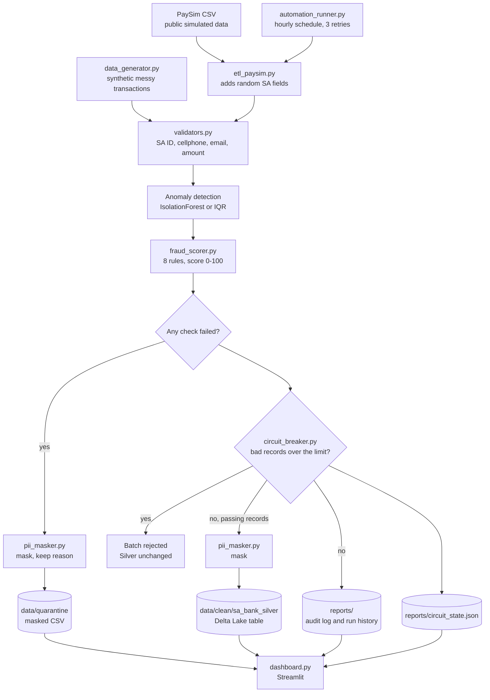

# SA Bank Data Quality Pipeline

A Python batch pipeline that checks South African banking transactions for data quality problems. It validates SA ID numbers, cellphones and emails, moves failed records to quarantine with the reason they failed, scores fraud risk with explainable rules, masks PII, and writes accepted records to a Delta Lake table. A circuit breaker rejects any batch with too many bad records.

**All data is synthetic or simulated.** `main.py` generates its own transactions with Faker and deliberately adds errors. `etl_paysim.py` uses the public [PaySim](https://www.kaggle.com/datasets/ealaxi/paysim1) simulated dataset and adds randomly generated SA fields. No real customer or bank data is involved.

[View the results page](https://sa-bank-data-quality-pipeline-1.onrender.com/), a static snapshot of one run.

## Architecture



The scheduler only runs the PaySim path. In `main.py`, Great Expectations also runs on the accepted records before the audit log is written.

## How each stage works

| Stage | What it does |
|---|---|
| **Generate** (`src/data_generator.py`) | Builds transactions from a fixed seed. About 20% of SA IDs are invalid, 15% of phone numbers are landlines and 10% of emails are malformed. It also adds missing names, inflated amounts and duplicate transaction IDs. |
| **Validate** (`src/validators.py`) | Checks that SA IDs have 13 digits, a valid date, a citizenship digit and a Luhn checksum (using `python-stdnum`). Cellphones must match `0[6-8]` plus 8 digits. Amounts must be between R0.01 and R1,000,000. |
| **Detect anomalies** | `main.py` runs IsolationForest on the amount, with `contamination=0.05`. It falls back to a 3×IQR rule if scikit-learn isn't installed. `etl_paysim.py` always uses the IQR rule. |
| **Score fraud** (`src/fraud_scorer.py`) | Adds up the eight rules below. A score of 40 or more sets `fraud_flag`. Fraud flags don't send a record to quarantine. |
| **Quarantine** | Any failed check sends the record to `data/quarantine/quarantined_batch.csv`. `quarantine_reason` lists every failed check, and PII is masked before the file is written. |
| **Circuit breaker** (`src/circuit_breaker.py`) | Rejects a batch whose bad-record rate is over the limit, so Silver isn't changed. After 5 rejected batches in a row, the state moves to `OPEN`. After 300 seconds it moves to `HALF_OPEN`, and the next batch decides whether it closes or reopens. |
| **Mask** (`src/pii_masker.py`) | Replaces name, SA ID, cellphone and email with a salted SHA-256 hash cut to 12 characters. It prints a warning if `PII_SALT` isn't set. |
| **Write Silver** | Overwrites a local Delta Lake table, or writes a CSV if the Delta write fails. |
| **Check and log** (`src/quality_checks.py`, `src/pipeline_logger.py`) | Runs 6 Great Expectations checks on the accepted records, then writes an audit log and adds a line to the run history. The results don't affect whether a batch is accepted. |
| **Dashboard** (`dashboard.py`) | Streamlit app that reads the output files. Its accepted or rejected banner comes from the circuit breaker's saved state. |
| **Results page** (`build_static_dashboard.py`) | Builds `index.html`, the page hosted on Render, from the latest `main.py` output. It's a snapshot, so it only changes when rebuilt and redeployed. |

### Fraud rules

| Rule | Condition | Score |
|---|---|---|
| R1 | Amount over R50,000 | +35 |
| R2 | Amount over R200,000 | +20 more |
| R3 | Duplicate transaction ID | +40 |
| R4 | Transaction between 00:00 and 05:00 | +15 |
| R5 | Invalid cellphone with a valid SA ID | +10 |
| R6 | Missing customer name | +15 |
| R7 | Withdrawal or cash-out category | +10 |
| R8 | Round amount of R5,000 or more | +8 |

## Results

These come from runs on 2 November 2026 with Python 3.13, using the real libraries and no fallbacks. The seeds are fixed, so the same input and library versions should give the same numbers.

| Measure | `main.py` (synthetic) | `etl_paysim.py` (PaySim sample) |
|---|---|---|
| Records | 5,000 | 10,000 |
| Quarantined | 2,278 (45.6%) | 4,016 (40.2%) |
| Written to Silver | 2,722 | 5,984 |
| Invalid SA ID | 987 | 1,945 |
| Invalid cellphone | 773 | 1,511 |
| Invalid email | 491 | 1,022 |
| Missing name | 303 | 0 (filled before validation) |
| Anomalous amount | 250 | 270 |
| Fraud flags | 46 (44 quarantined, 2 in Silver) | 4,670 |
| Circuit state | CLOSED | CLOSED |

A record can fail more than one check, so the reason counts add up to more than the quarantined total.

- **The high bad-record rate is by design.** The errors are injected to give the checks something to find.
- **Great Expectations scored 83.3% (5 of 6) on the synthetic run.** The check that fails is transaction ID uniqueness, because 2 duplicate rows reach Silver.
- **The fraud rules don't suit PaySim.** PaySim labels 19 of the 10,000 sampled records as fraud. The rules caught 18 of them, but also flagged 4,652 legitimate records, so only 0.4% of flags were correct. The thresholds are written for retail rand amounts, and PaySim's amounts are much larger.

## Design decisions

- **Quarantine instead of deleting.** Failed records stay available for review, and `quarantine_reason` shows what to fix without re-running the checks.
- **Mask quarantine as well as Silver.** Bad records hold the same personal data as good ones, so writing them unmasked would leave the most-inspected file unprotected. `transaction_id` stays readable so a record can be traced.
- **Work out reasons before masking.** The validators can't check a hashed value, so reasons are calculated first and carried with the record.
- **Rule-based fraud scoring.** Each score can be explained rule by rule, and no labelled training data is needed.
- **A configurable failure limit.** The default of 55% sits just above the injected error rate so the demo data can flow. It isn't a recommendation for real data, which would need a much lower limit.
- **Saved circuit state.** The state is kept in a JSON file so consecutive failures are still counted between separate runs.

## Known limitations and next steps

**Data checks**
- Duplicate transaction IDs are scored as a fraud signal but not quarantined, so some reach Silver. Next step: quarantine or dedupe them.
- IsolationForest always marks about 5% of records as anomalies, even in clean data. It looks only at the amount, so the highest amount left in Silver in this run was R7,172.17. Next step: use more features and a limit set from real distributions.
- Great Expectations results are only reported and can't stop a batch.

**Fraud scoring**
- The rules haven't been tuned or tested on labelled rand transactions, and they perform poorly on PaySim, as shown above. Treat the flags as a demonstration, not a working fraud detector.

**Privacy**
- Masking shows the kind of control POPIA calls for, but this project hasn't had a POPIA compliance review.
- Without `PII_SALT`, hashes use a salt that's public in this repo. SA IDs have few enough possible values to brute-force, so always set your own salt for anything but synthetic data.
- `data/raw/` still holds unmasked input. It's ignored by git, and here the values are synthetic.
- `mask_mode="token"` exists in the code, but neither pipeline uses it.

**Pipeline behaviour**
- Each `main.py` run regenerates the same seeded data, and each scheduled PaySim run samples the same rows, so repeat runs don't process new data.
- Silver is overwritten on every run. There's no incremental load or merge.
- While the circuit is `OPEN`, a batch under the limit still closes it, even before the 300-second recovery window ends.
- Only `automation_runner.py --once` has been run, not a long-running schedule. Webhook alerts are off by default.
- There's no automated test suite or CI yet. Next step: `pytest` coverage for the validators, fraud scorer and circuit breaker, run by GitHub Actions.

## Quickstart

You need Python 3.10 or later. This was tested on Windows with Python 3.13.

```bash
git clone https://github.com/ntokozo078/SA-bank-data-quality-pipeline.git
cd SA-bank-data-quality-pipeline
python -m venv .venv
```

Activate the environment on **Windows (PowerShell)**:

```powershell
.venv\Scripts\Activate.ps1
```

Or on **macOS/Linux**:

```bash
source .venv/bin/activate
```

Then install the dependencies and run the pipeline:

```bash
pip install -r requirements.txt
python main.py
```

Open the dashboard at `http://localhost:8501`:

```bash
streamlit run dashboard.py
```

### Options

```bash
python main.py 10000                    # generate 10,000 records
python main.py --max-failure-rate 20    # see the circuit breaker reject the batch
python build_static_dashboard.py        # rebuild index.html from the latest accepted run
```

You can also set the failure limit with the `MAX_FAILURE_RATE` environment variable. The `--max-failure-rate` flag takes priority.

To set your own masking salt on **Windows (PowerShell)**:

```powershell
$env:PII_SALT = "choose-a-long-random-value"
```

Or on **macOS/Linux**:

```bash
export PII_SALT="choose-a-long-random-value"
```

### PaySim and the scheduler

[Download the PaySim CSV](https://www.kaggle.com/datasets/ealaxi/paysim1) into `data/raw/`, keeping its `PS_` filename:

```bash
python etl_paysim.py --input data/raw/PS_20174392719_1491204439457_log.csv --sample 10000
python automation_runner.py --once
```

Run `python automation_runner.py` without `--once` to keep it running on an hourly schedule.

## Project layout

```text
main.py                 Synthetic data pipeline
etl_paysim.py           PaySim pipeline
automation_runner.py    Scheduler and retries for the PaySim pipeline
dashboard.py            Streamlit dashboard
build_static_dashboard.py  Builds index.html from pipeline output
index.html              Static results page hosted on Render
src/
  data_generator.py     Synthetic transactions with injected errors
  validators.py         Field checks and quarantine reasons
  fraud_scorer.py       Fraud rules
  circuit_breaker.py    Batch rejection and saved state
  pii_masker.py         Hash and token masking
  quality_checks.py     Great Expectations, with a pandas fallback
  pipeline_logger.py    Run history
```

---

**Ntokozo Ntombela** · Graduate Data Engineer · Microsoft Certified: Fabric Data Engineer Associate (DP-700)
[LinkedIn](https://www.linkedin.com/in/ntokozo-ntombela-ba662235a) · [Portfolio](https://data-engineering-portfolio-xi.vercel.app/)
